<!-- Profile README of Özcan Orhan Demirci. Media and how to rebuild it: see UPDATING.md. -->

<a href="#selected-work">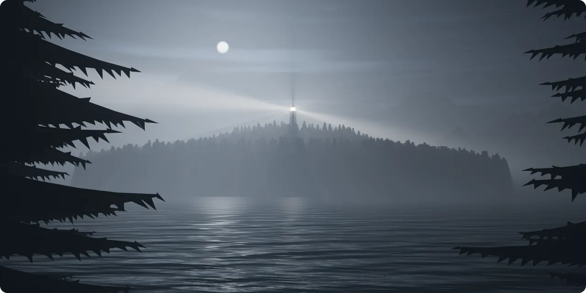</a>

Rendered in my own GPU engine, <a href="https://github.com/OzcanOrhanDemirci/pc_graphics">pc_graphics</a>: C++20, CUDA and OptiX, no engine underneath.

<h3 align="center">I decide. AI builds. I verify.</h3>

I'm Özcan Orhan Demirci, a developer in İzmir. I build mobile apps, GPU graphics and electronics, and I teach young people to build with AI. I work as the architect: I decide what gets built and how, AI writes the code, and I check every result on the device itself. **Open to work:** roles and projects, write to [mail@ozcanorhandemirci.com](mailto:mail@ozcanorhandemirci.com).

## <picture><source media="(prefers-color-scheme: dark)" srcset="media/headings/n01-dark.png"></picture> Live

### ChefOl

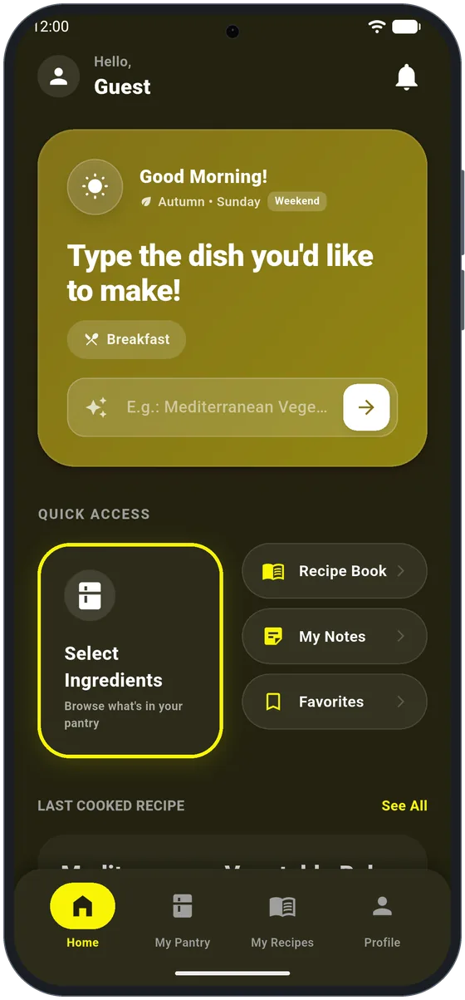

An AI recipe app that turns what is in your kitchen into step-by-step recipes, in Turkish and English. I designed, built and shipped all of it on my own.

- A safety system for 37 allergens, 28 intolerances and 23 lifestyles, with baby, child, pregnancy and breastfeeding modes
- Every AI answer passes an ingredient pre-filter, prompt safety rules and a Turkish-aware allergen matcher, backed by 7,000+ automated tests
- Flutter on iOS and Android; the AI backend on Cloudflare Workers with Firebase sign-in and rate limiting

&nbsp;

[chefolapp.com](https://chefolapp.com) · [How it is built](https://github.com/OzcanOrhanDemirci/chefol-showcase)

 

### Bilgi Yarışması

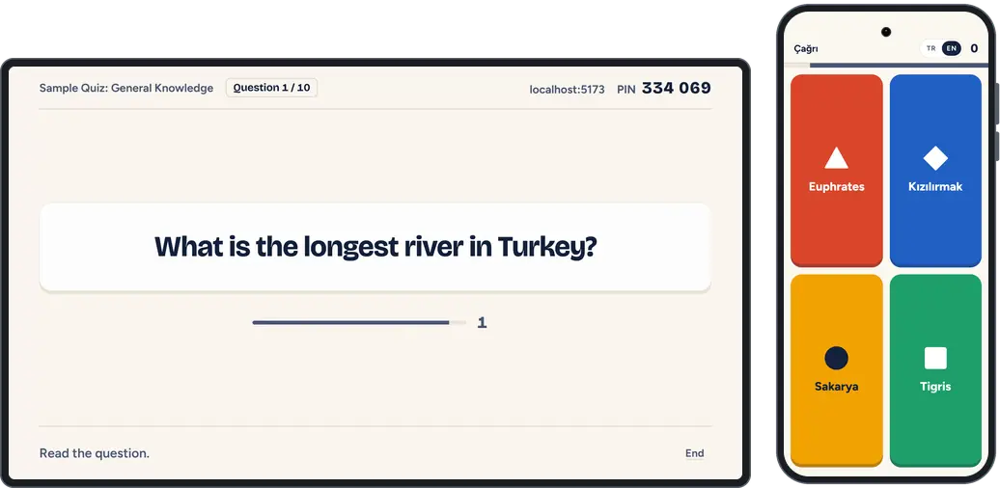

A live quiz web app I built for Alsancak Youth Centre in İzmir to take the place of Kahoot! there; hundreds of students, in time perhaps thousands, will play it. The quiz runs on the projector, players join from their own phones with a QR code, no app and no account, and all of it runs on Cloudflare's free tier.

- One Durable Object per game keeps the clock and the scores; each answer's time is corrected for the phone's own measured latency, and 400 bot players on simulated mobile networks finished a game on Cloudflare

[How it is built](https://github.com/OzcanOrhanDemirci/bilgi-yarismasi-showcase)

## <picture><source media="(prefers-color-scheme: dark)" srcset="media/headings/n02-dark.png"></picture> Selected work

<!-- cards:en -->

<a href="https://github.com/OzcanOrhanDemirci/Mode_Code">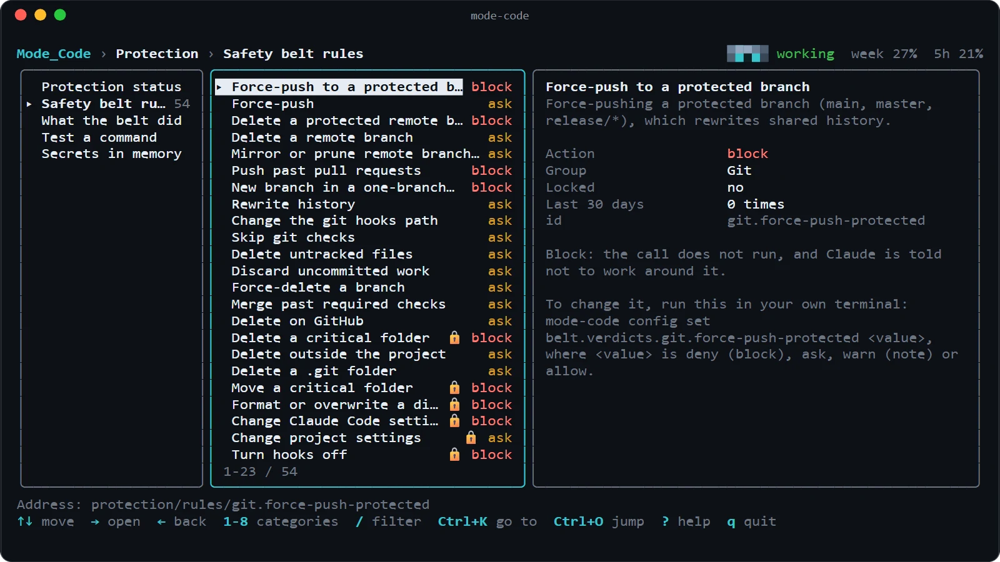</a>

<b><a href="https://github.com/OzcanOrhanDemirci/Mode_Code">Mode_Code</a></b> 
A safety belt, modes and a quota guard for Claude Code. Every shell command and file write is parsed the way the shell and git will read it, then decided against 54 rules before it runs. 
TypeScript · Claude Code plugin · open source

 

<a href="https://github.com/OzcanOrhanDemirci/pc_graphics">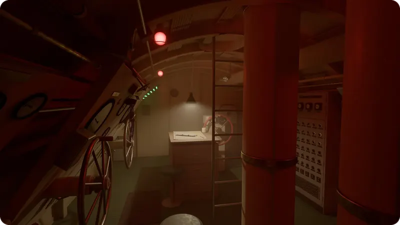</a>

<b><a href="https://github.com/OzcanOrhanDemirci/pc_graphics">pc_graphics</a></b> 
Art-directed scenes on my own spectral path tracer. Every ray of light is computed; nothing is painted on. 
C++20 · CUDA · OptiX · open source

 

<a href="https://github.com/OzcanOrhanDemirci/kontrol-merkezi">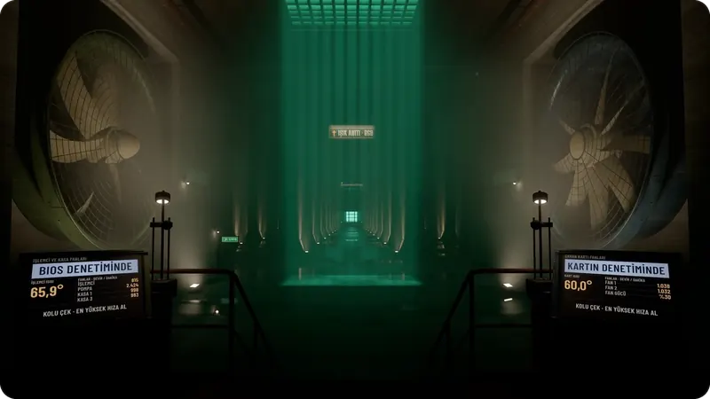</a>

<b><a href="https://github.com/OzcanOrhanDemirci/kontrol-merkezi">Kontrol Merkezi</a></b> 
My PC's fans and RGB lighting in one Windows app, staged as a 3D hall you walk through. 
C# · WebGL2 · C++ · OptiX · open source

 

<a href="https://github.com/OzcanOrhanDemirci/stress_test">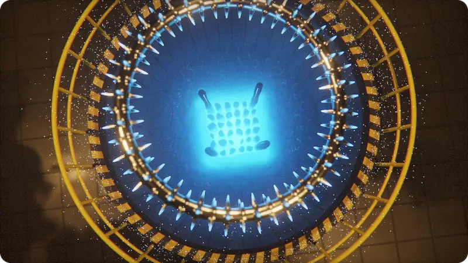</a>

<b><a href="https://github.com/OzcanOrhanDemirci/stress_test">stress_test</a></b> 
Finds the most power a phone can really draw: AArch64 assembly CPU loads, Vulkan GPU burners and cinematic scenes, a PDF report. 
Kotlin · Vulkan · AArch64

 

<a href="https://github.com/OzcanOrhanDemirci/archaeology-app">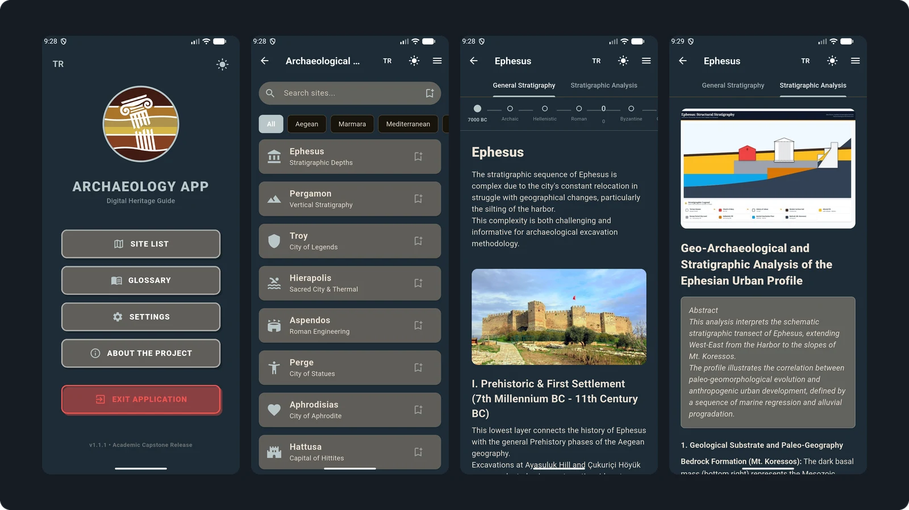</a>

<b><a href="https://github.com/OzcanOrhanDemirci/archaeology-app">archaeology-app</a></b> 
Anatolia Heritage: an offline, bilingual guide to 21 archaeological sites of Türkiye. My graduation project. 
Flutter · Dart · open source

 

<a href="https://github.com/OzcanOrhanDemirci/weather_app">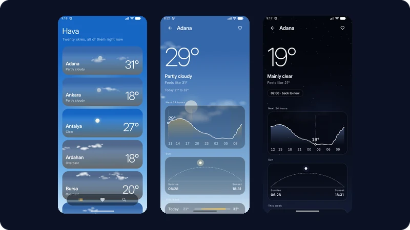</a>

<b><a href="https://github.com/OzcanOrhanDemirci/weather_app">Hava</a></b> 
An Android weather app where the backdrop is the data. Written at a youth camp. 
Kotlin · Jetpack Compose · Open-Meteo

 

<a href="https://github.com/OzcanOrhanDemirci/Mobil_App_Check_List">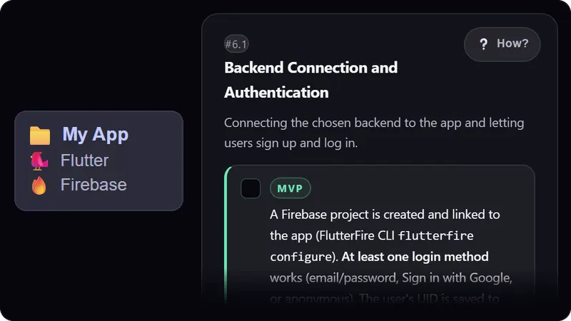</a>

<b><a href="https://github.com/OzcanOrhanDemirci/Mobil_App_Check_List">Mobil_App_Check_List</a></b> 
A pre-launch quality checklist for mobile apps: 55 items that adapt to 6 frameworks and 9 backends. Works offline. 
JavaScript · PWA · open source

<!-- /cards:en -->

<!-- showreel:en: the player is GitHub's (Özcan's upload in issue #1); the moving poster plays where the player does not. The poster has no link: GitHub turns a link to an uploaded video into a second player. -->
## <picture><source media="(prefers-color-scheme: dark)" srcset="media/headings/n03-dark.png"></picture> Showreel

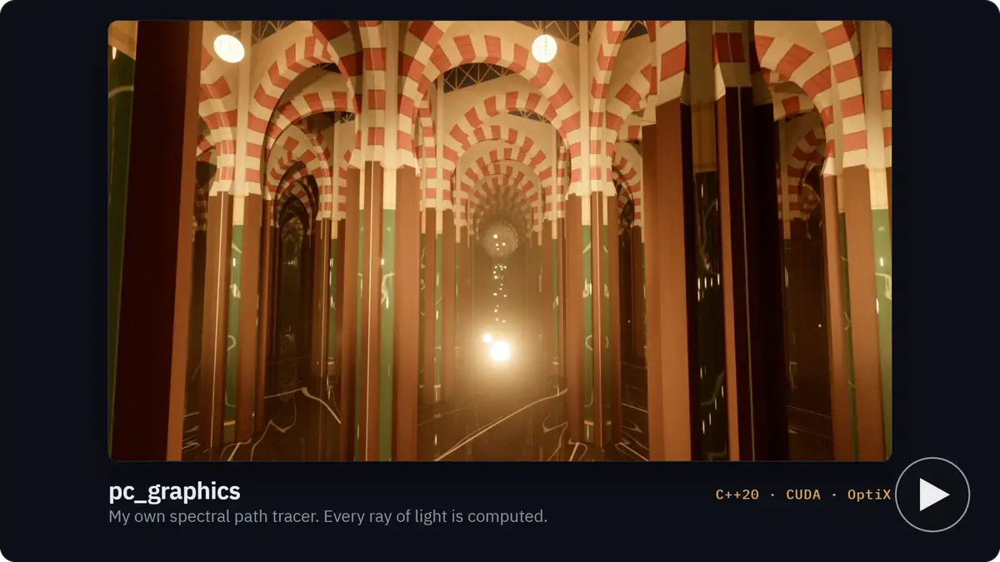

My projects in motion, one scene each, 58 seconds:

https://github.com/user-attachments/assets/32a9bb71-ac27-4db9-bb8f-b173e35eaab9

## <picture><source media="(prefers-color-scheme: dark)" srcset="media/headings/n04-dark.png"></picture> How I work

**I decide.** What gets built, why, and its architecture. 
**AI builds.** Claude Code writes the code; Codex takes parts of it. 
**I verify.** On the screen and on the bench, not only in tests. Every commit is signed with my key and shows as Verified, with the AI tools named in it.

Flutter · Dart · Kotlin · Jetpack Compose · C++ · CUDA · OptiX · Vulkan · TypeScript · Cloudflare Workers · Firebase · Arduino · Claude Code · Codex

## <picture><source media="(prefers-color-scheme: dark)" srcset="media/headings/n05-dark.png"></picture> Teaching

- **GENÇ2030**, Ministry of Youth and Sports: one of 500 volunteer AI instructors selected across Türkiye. An AI conference for hundreds of high-school students in Menemen; instructor training for about 90 instructors at the Mersin camp.

- **Alsancak Youth Centre R&D**: taught a 12-week AI-assisted mobile development course, where my students built 8 apps. This term I teach its robotics and 3D modelling course.

- **DENEYAP**: project advisor to 4 teams and 16 students preparing for TEKNOFEST and TÜBİTAK; jury member in the 2026 student selection, 38 candidates.

- **Education**: Computer Programming, İstanbul University. Management Information Systems (in English), İzmir Bakırçay University, ongoing. Graduate of the Google AI and Technology Academy (T3 Foundation and Google).

## <picture><source media="(prefers-color-scheme: dark)" srcset="media/headings/n06-dark.png"></picture> Contact

[mail@ozcanorhandemirci.com](mailto:mail@ozcanorhandemirci.com) · [LinkedIn](https://www.linkedin.com/in/ozcan-orhan-demirci)

 

<b>Türkçe</b>

 

<h3 align="center">Ben karar veririm, AI uygular, ben denetlerim.</h3>

Ben Özcan Orhan Demirci, İzmir'de yaşayan bir geliştiriciyim. Mobil uygulamalar, GPU grafikleri ve elektronik projeler geliştiriyor, gençlere yapay zekâyla üretmeyi öğretiyorum. Mimar olarak çalışırım: neyin nasıl yapılacağına ben karar veririm, kodu yapay zekâ yazar, her sonucu cihazın kendisinde ben denetlerim. **İş arıyorum:** pozisyon ve projeler için [mail@ozcanorhandemirci.com](mailto:mail@ozcanorhandemirci.com).

En üstteki döngü kendi GPU motorumda çizildi: <a href="https://github.com/OzcanOrhanDemirci/pc_graphics">pc_graphics</a>; C++20, CUDA ve OptiX, altında hazır bir motor yok.

## <picture><source media="(prefers-color-scheme: dark)" srcset="media/headings/n01-dark.png"></picture> Canlıda

### ChefOl

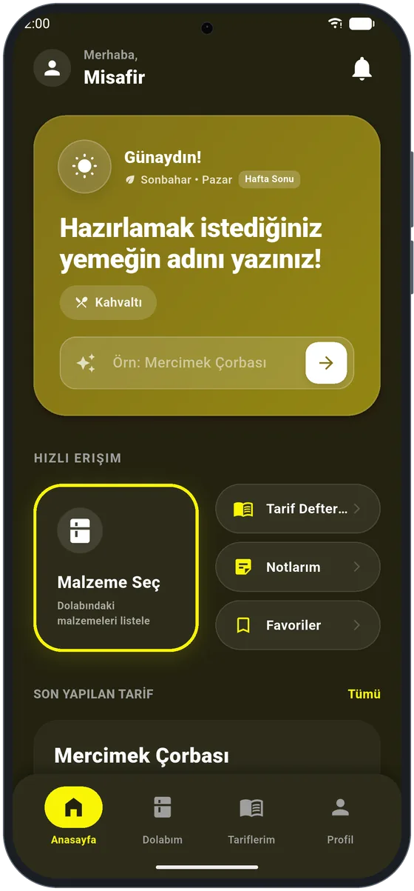

Evdeki malzemeleri adım adım tariflere dönüştüren, Türkçe ve İngilizce yapay zekâ destekli yemek uygulaması. Tamamını tek başıma tasarladım, geliştirdim ve yayınladım.

- 37 alerjen, 28 intolerans ve 23 yaşam tarzını kapsayan güvenlik sistemi; bebek, çocuk, hamilelik ve emzirme modları
- Her yapay zekâ yanıtı malzeme ön filtresinden, istem güvenlik kurallarından ve Türkçe çekim eklerini tanıyan alerjen eşleştiriciden geçer; arkasında 7.000'den fazla otomatik test
- iOS ve Android için Flutter; yapay zekâ altyapısı Cloudflare Workers üzerinde, Firebase kimlik doğrulaması ve istek sınırıyla

&nbsp;

[chefolapp.com](https://chefolapp.com) · [Nasıl yapıldı](https://github.com/OzcanOrhanDemirci/chefol-showcase)

 

### Bilgi Yarışması

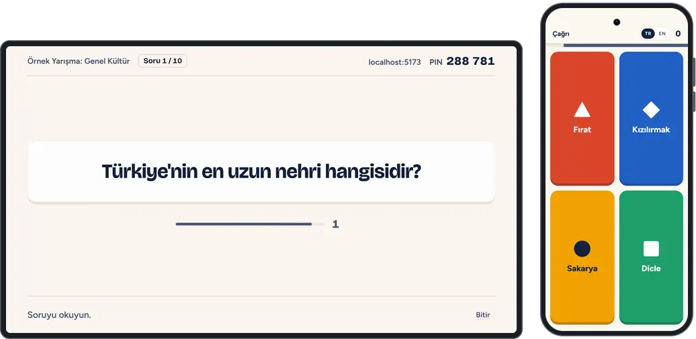

İzmir'deki Alsancak Gençlik Merkezi'nde Kahoot! yerine kullanılmak üzere yaptığım canlı bilgi yarışması web uygulaması; yüzlerce, zamanla belki binlerce öğrenci oynayacak. Yarışma projeksiyonda akar, oyuncular uygulama indirmeden ve hesap açmadan QR kodla kendi telefonlarından katılır; hepsi Cloudflare'in ücretsiz katmanında çalışır.

- Her oyunu tek bir Durable Object yönetir, saat ve puanlar onda durur; her cevabın süresi o telefonun ölçülen gecikmesine göre düzeltilir ve benzetilmiş mobil ağlarda 400 bot oyuncu Cloudflare'de bir oyunu baştan sona oynadı

[Nasıl yapıldı](https://github.com/OzcanOrhanDemirci/bilgi-yarismasi-showcase)

## <picture><source media="(prefers-color-scheme: dark)" srcset="media/headings/n02-dark.png"></picture> Seçili işler

<!-- cards:tr -->

<a href="https://github.com/OzcanOrhanDemirci/Mode_Code">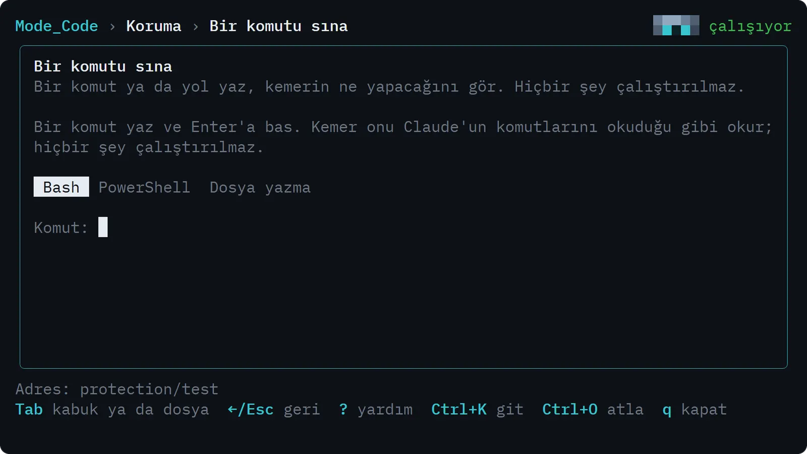</a>

<b><a href="https://github.com/OzcanOrhanDemirci/Mode_Code">Mode_Code</a></b> 
Claude Code için emniyet kemeri, modlar ve kota bekçisi. Her kabuk komutu ve dosya yazma, kabuğun ve git'in okuyacağı gibi ayrıştırılır ve çalışmadan önce 54 kurala göre karara bağlanır. 
TypeScript · Claude Code eklentisi · açık kaynak

 

<b><a href="https://github.com/OzcanOrhanDemirci/pc_graphics">pc_graphics</a></b> 
Kendi spektral yol izleyicimde sanat yönetimli sahneler. Işığın her ışını hesaplanır, hiçbir şey boyanmaz. 
C++20 · CUDA · OptiX · açık kaynak

 

<b><a href="https://github.com/OzcanOrhanDemirci/kontrol-merkezi">Kontrol Merkezi</a></b> 
Bilgisayarımın fanları ve RGB ışıkları tek bir Windows uygulamasında, içinde yürünen 3B bir salon olarak. 
C# · WebGL2 · C++ · OptiX · açık kaynak

 

<b><a href="https://github.com/OzcanOrhanDemirci/stress_test">stress_test</a></b> 
Bir telefonun gerçekten çekebildiği en yüksek gücü bulur: AArch64 assembly işlemci yükleri, Vulkan GPU yakıcıları ve sinematik sahneler, PDF rapor. 
Kotlin · Vulkan · AArch64

 

<a href="https://github.com/OzcanOrhanDemirci/archaeology-app">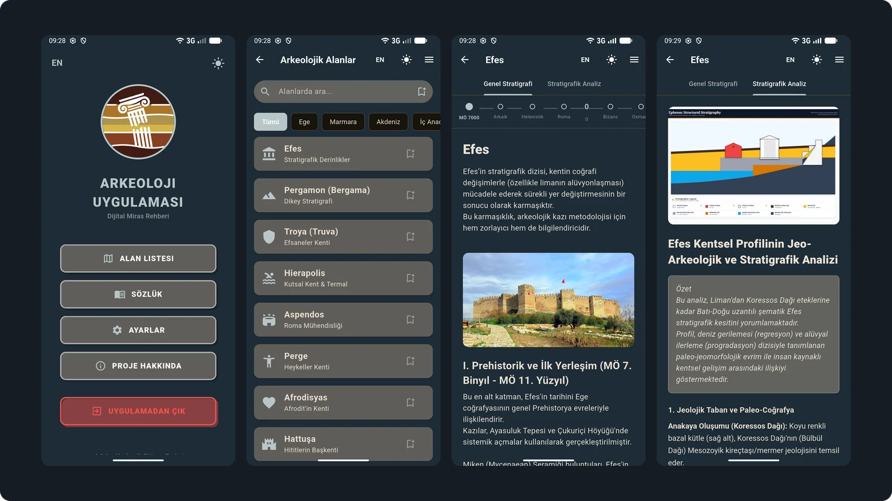</a>

<b><a href="https://github.com/OzcanOrhanDemirci/archaeology-app">archaeology-app</a></b> 
Anatolia Heritage: Türkiye'nin 21 arkeolojik alanı için çevrimdışı, iki dilli rehber. Bitirme projem. 
Flutter · Dart · açık kaynak

 

<b><a href="https://github.com/OzcanOrhanDemirci/weather_app">Hava</a></b> 
Arka planın kendisinin veri olduğu bir Android hava durumu uygulaması. Bir gençlik kampında yazıldı. 
Kotlin · Jetpack Compose · Open-Meteo

 

<a href="https://github.com/OzcanOrhanDemirci/Mobil_App_Check_List">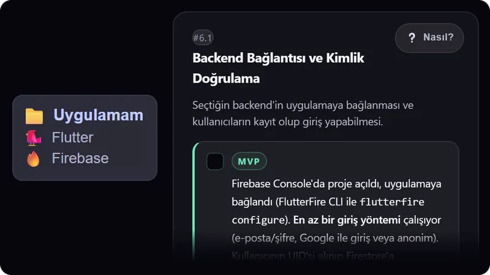</a>

<b><a href="https://github.com/OzcanOrhanDemirci/Mobil_App_Check_List">Mobil_App_Check_List</a></b> 
Mobil uygulamalar için yayın öncesi kalite kontrol listesi: 6 çatıya ve 9 arka uca uyan 55 madde. Çevrimdışı çalışır. 
JavaScript · PWA · açık kaynak

<!-- /cards:tr -->

<!-- showreel:tr -->
## <picture><source media="(prefers-color-scheme: dark)" srcset="media/headings/n03-dark.png"></picture> Tanıtım videosu

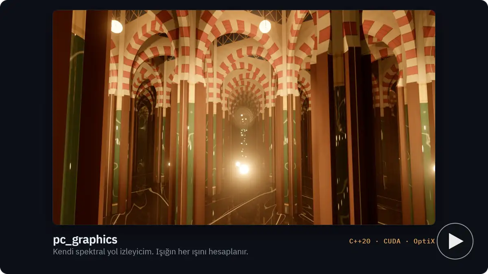

Projelerim hareket halinde, her birine bir sahne, 58 saniye:

https://github.com/user-attachments/assets/3644fdd6-a4bd-4972-916c-98cbef2d52f1

## <picture><source media="(prefers-color-scheme: dark)" srcset="media/headings/n04-dark.png"></picture> Nasıl çalışırım

**Ben karar veririm.** Neyin, neden yapılacağına ve mimarisine. 
**Yapay zekâ uygular.** Kodu Claude Code yazar; bir kısmını Codex üstlenir. 
**Ben denetlerim.** Yalnız testlerde değil, ekranda ve tezgâhta. Her commit kendi anahtarımla imzalı ve Verified görünür; içinde kullanılan yapay zekâ araçlarının adı yazar.

Flutter · Dart · Kotlin · Jetpack Compose · C++ · CUDA · OptiX · Vulkan · TypeScript · Cloudflare Workers · Firebase · Arduino · Claude Code · Codex

## <picture><source media="(prefers-color-scheme: dark)" srcset="media/headings/n05-dark.png"></picture> Eğitmenlik

- **GENÇ2030**, Gençlik ve Spor Bakanlığı: Türkiye genelinde seçilen 500 gönüllü yapay zekâ eğitmeninden biriyim. Menemen'de yüzlerce lise öğrencisine yapay zekâ konferansı; Mersin kampında 90'a yakın eğitmene eğitmen eğitimi.

- **Alsancak Gençlik Merkezi AR-GE**: 12 haftalık Yapay Zekâ Destekli Mobil Uygulama Geliştirme Kursu'nu verdim, öğrencilerim 8 uygulama geliştirdi. Bu dönem robotik ve 3D modelleme kursunun eğitmeniyim.

- **DENEYAP**: TEKNOFEST ve TÜBİTAK'a hazırlanan 4 takıma, 16 öğrenciye proje danışmanlığı; 2026 Öğrenci Seçme Süreci'nde jüri üyesi, 38 aday.

- **Eğitim**: İstanbul Üniversitesi Bilgisayar Programcılığı. İzmir Bakırçay Üniversitesi Yönetim Bilişim Sistemleri (İngilizce), devam ediyor. Yapay Zekâ ve Teknoloji Akademisi mezunu (T3 Vakfı ve Google).

## <picture><source media="(prefers-color-scheme: dark)" srcset="media/headings/n06-dark.png"></picture> İletişim

[mail@ozcanorhandemirci.com](mailto:mail@ozcanorhandemirci.com) · [LinkedIn](https://www.linkedin.com/in/ozcan-orhan-demirci)

 

App Store and the Apple logo are trademarks of Apple Inc. Google Play and the Google Play logo are trademarks of Google LLC. Kahoot! is a trademark of Kahoot! ASA; my quiz app is not affiliated with or endorsed by it. Other names and logos belong to their owners.
